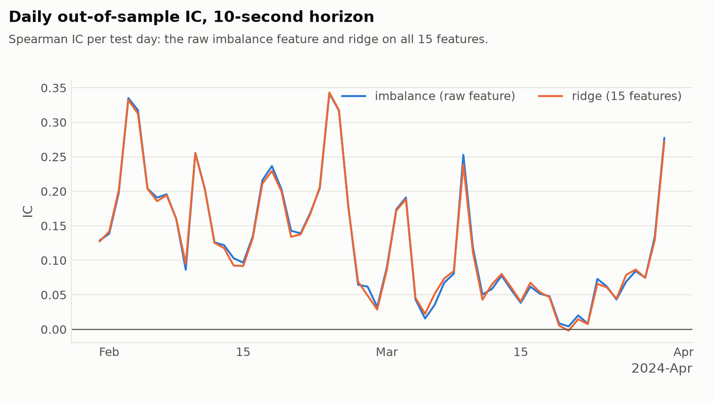
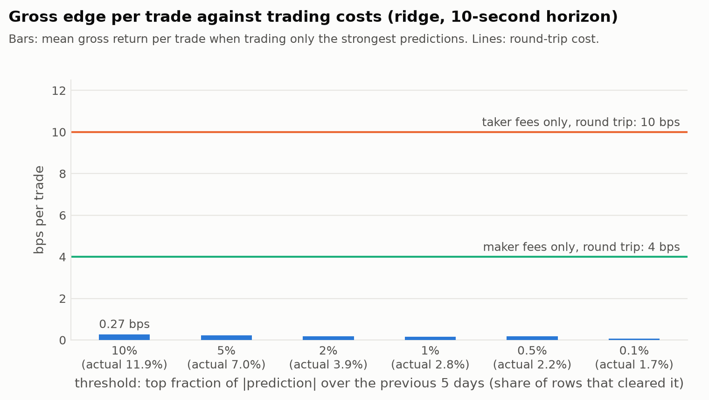
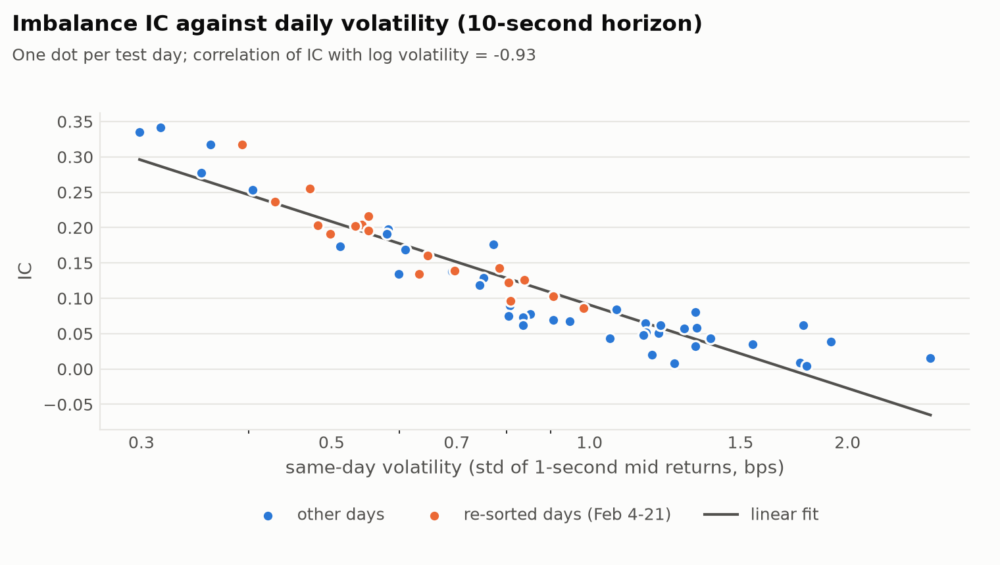
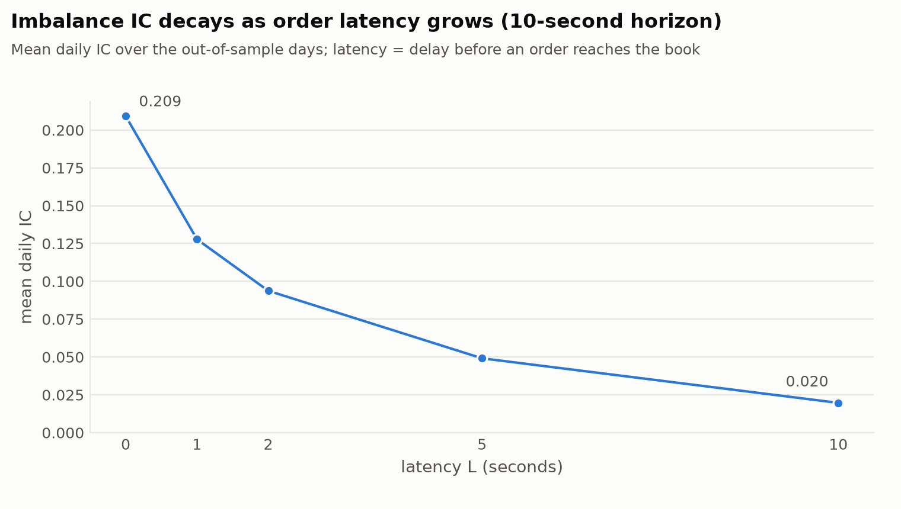

# Short-horizon signal research on BTCUSDT perpetual futures

Can the top of the order book predict the next few seconds of mid-price, and is any of it tradable
after fees? Short answer: **yes to the first, no to the second.** The signal is real and
statistically solid, but it is worth roughly 0.1 to 0.27 bps per trade against about 10 bps
(taker) or 4 bps (maker, optimistic) of round-trip cost.

## Setup

- **Data:** Binance USD-M BTCUSDT `bookTicker` and `aggTrades`, 2024-01-01 to 2024-03-30 (90 days).
- **Grid:** one row per second, labelled by its end time. Features use only the last event strictly
  before that second.
- **Target:** forward mid-price return in bps, `(mid[t+L+h] / mid[t+L] - 1) * 1e4`, with
  execution latency L = 1 s and horizons h = 1, 5, 10, 30 s. **Primary: h = 10 s.**
- **Features:** 15 book/trade state features (imbalance, spread, depth, update rate, signed order
  and trade flow, and so on).
- **Baseline:** the raw top-of-book imbalance, scored as is, with no fitting. Declared before any
  results were looked at.
- **Model:** ridge regression on all 15 features, one model per horizon, solved in closed form from
  per-day sufficient statistics. The shrinkage strength is chosen on validation IC.
- **Validation:** expanding-window walk-forward at day level. 30 days minimum training (25 fit +
  5 validation), 60 out-of-sample test days (2024-01-31 to 2024-03-30), 60 s purge between train
  and test.
- **Metric:** Spearman IC per day, then mean and t-statistic across days. Comparisons between
  signals are paired by day.

## Results

Mean daily IC over the 60 test days (t-statistic across days in brackets):

| Horizon | Imbalance (baseline) | Ridge | Ridge - imbalance (paired t) |
|---|---|---|---|
| 1 s | 0.1928 (18.4) | 0.1902 (18.2) | -0.0026 (-6.8) |
| 5 s | 0.1627 (12.3) | 0.1608 (12.3) | -0.0019 (-4.6) |
| **10 s** | **0.1278 (11.2)** | **0.1268 (11.3)** | **-0.0010 (-1.5)** |
| 30 s | 0.0679 (10.1) | 0.0712 (10.6) | +0.0033 (+3.3) |



- Almost all of the signal is in one raw feature. Ridge on all 15 features is slightly worse than
  the single imbalance feature at 1 and 5 s, indistinguishable at 10 s, and slightly better at 30 s.
- Realised 10 s return by tenth of the ridge prediction: -0.27 bps in the lowest tenth, +0.29 bps in
  the highest; top minus bottom +0.57 bps (t = 16).
- Daily t-statistics treat days as independent, which they roughly are but not exactly; with four
  horizons and many candidate features there is also a multiple-comparison caveat, which is why the
  baseline was fixed in advance.

### Costs and PnL

Trade only the strongest predictions (|prediction| above the level that the top x% of the previous
5 days' predictions would have cleared), one position at a time, held for 10 s. Gross edge per
trade is also the break-even round-trip cost.

| Nominal top fraction | Trades per day | Gross bps per trade |
|---|---|---|
| 10% | 2,734 | 0.265 |
| 5% | 1,850 | 0.225 |
| 2% | 1,035 | 0.189 |
| 1% | 645 | 0.148 |
| 0.5% | 410 | 0.171 |
| 0.1% | 211 | 0.072 |

| Round-trip cost | bps |
|---|---|
| Taker: 2 x 5 bps fee + spread crossed (the spread is about 0.02 bps on BTCUSDT) | about 10 |
| Maker: 2 x 2 bps fee, assuming every order fills and there is no adverse selection | about 4 |



At the best threshold the edge is about 0.27 bps per trade: roughly 15 times too small for a maker
(an upper bound) and 38 times too small for a taker. Net per trade is about -3.7 bps (maker) and
-9.8 bps (taker). The bars are labelled with the nominal threshold and, in brackets, the share of
rows that actually cleared it (see "What did not work").

Threshold chosen on the first 29 test days and judged on the last 30, mean daily PnL: zero cost
+455 bps/day (t = 3.6), maker -1,301 bps/day (t = -1.2), taker -3,329 bps/day (t = -1.2). With
costs, the rule picks the smallest fraction (fewest trades), which loses least. **There is no
profitable configuration.** The deciding fact is the per-trade arithmetic above, not the t-statistic
of the 30-day totals.

### The edge depends on the market regime

IC is much higher on quiet days. The daily imbalance IC at 10 s ranges from 0.004 to 0.34; the mean
is 0.10 on weekdays (43 days) and 0.21 on weekends (17 days). It correlates -0.93 with log same-day
volatility. Split by *previous-day* volatility (usable in real time), ridge, top 1% of predictions:

| Previous-day volatility | IC | Label std (bps) | Gross bps per trade |
|---|---|---|---|
| Low | 0.208 | 2.1 | 0.27 |
| Middle | 0.115 | 3.0 | 0.16 |
| High | 0.057 | 4.3 | 0.10 |



IC is scale-free, and the label's standard deviation grows with volatility, so the edge in bps falls
somewhat less than the IC does. Even the best regime is far below costs.

## Checks

- **Unit and perturbation tests:** changing any data after time t must not change features at t;
  changing test-day data must not change predictions for earlier days.
- **Placebo:** scoring the signal against another day's labels, or against its own day's labels
  rotated by 1 h or 6 h, gives IC about 0. Note: this checks for patterns shared by signal and
  label and shows the null noise level. It does **not** detect look-ahead; in a planted-leak test
  the real IC was 0.83 and the placebo still 0.
- **Latency decay:** IC falls as the assumed latency L rises, which is what a real, perishable
  signal does and what a look-ahead bug would not do.

  
- **Purge sensitivity:** a 3,600 s purge instead of 60 s changes ridge IC by at most 0.0005.
- **Data repair:** 19 `bookTicker` days were interleaved in Binance's own CSV. They are re-sorted
  by `update_id`. Their higher IC turned out to be the volatility regime (after controlling for
  volatility, update rate and weekends, the repaired-day effect is -0.0065, t = -0.55).

## What did not work

- **Ridge did not beat a single feature.** The signal is close to one-dimensional: a linear
  combination of all 15 features is no better than raw imbalance at horizons up to 10 s.
- **Nothing survives costs.** Not at any threshold or regime tested, and not under the optimistic
  maker assumption.
- **Same-day volatility is not a filter.** It explains IC beautifully but is unknown in advance.
- **Choosing ridge strength by squared error** hurt at weak signal (IC 0.013 versus 0.020 at a
  10 s latency), so strength is chosen by validation IC. Not an issue at L = 1 s.
- **The trailing-quantile threshold drifts.** The level for "top 1%" comes from the previous 5 days'
  predictions, so when the market regime changes, the share of rows that clear it changes too. For
  ridge the top 1% traded about 2.8 times more rows than nominal (2,394 versus 864 per day) and the
  top 0.1% about 17 times more (1,498 versus 86). Edge per signal against threshold is therefore
  noisy (0.07 bps at 5%, 0.79 bps at 0.5%) and I do not interpret its shape. The `signal_share`
  column of the script output shows the actual share.
- **Mistake caught along the way:** I first described the cross-day placebo as a leakage test. It is
  not (see above).

## Limitations

- One symbol, one quarter, one fee schedule; a single regime sequence.
- Only a linear model is evaluated here. A non-linear model might extract more of the signal; the
  conclusion above is about ridge and the raw feature.
- 1-second bars throw away everything inside the second; real HFT edge lives in microseconds.
- 1 s latency is far slower than a colocated trader.
- Costs: Binance regular-user fees (maker 0.02%, taker 0.05%, 10% BNB discount not applied); higher
  VIP tiers or rebates would lower them. No market impact, no queue position, no funding.
- The maker scenario ignores fill probability and adverse selection, so it is optimistic.

## Layout

```
scripts/   01_fetch_binance.py  02_build_features.py  03_run_walkforward.py  04_costs_and_pnl.py
utils/     audit_raw.py  check_csv_order.py  diagnose_repaired_days.py  latency_table.py
           list_runs.py  make_plots.py  placebo_checks.py
src/signal_research/   config, features, labels, metrics, dataset, walkforward, placebo, trading
tests/     pytest suite (features, labels, metrics, walk-forward, placebo, trading)
docs/figures/          the figures above
NOTES.md   running log: decisions, data findings, lessons
```

## Reproduce

```
pip install -r requirements.txt
pip install -e .
python scripts/01_fetch_binance.py download --start 2024-01-01 --end 2024-03-30
python utils/audit_raw.py
python scripts/02_build_features.py --start 2024-01-01 --end 2024-03-30
pytest
python scripts/03_run_walkforward.py            # ridge + baselines -> data/walkforward
python scripts/04_costs_and_pnl.py              # deciles, edge, costs, regimes
python utils/placebo_checks.py
python utils/diagnose_repaired_days.py
python utils/make_plots.py                      # -> docs/figures
```

The latency figure also needs runs at other latencies, for example
`python scripts/03_run_walkforward.py --latency 5 --out data/wf_L5`, one folder per latency
(`wf_L0`, `wf_L2`, `wf_L5`, `wf_L10`). `python utils/list_runs.py` lists every results folder with
the settings that produced it.
